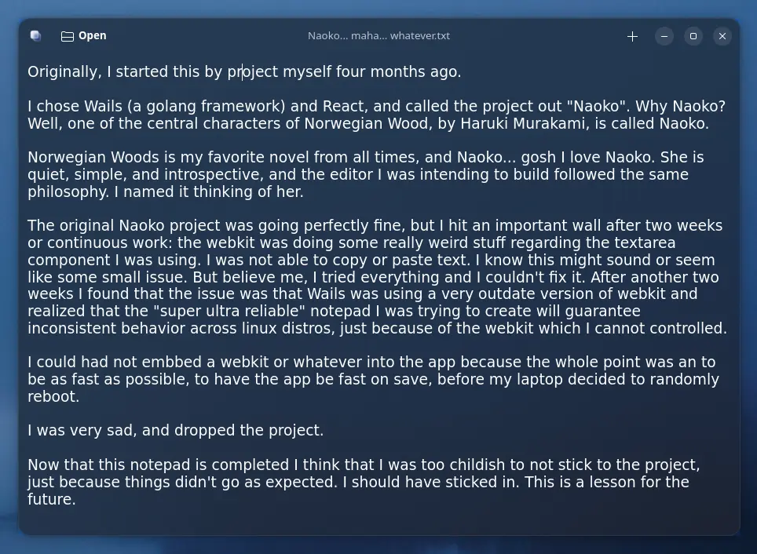
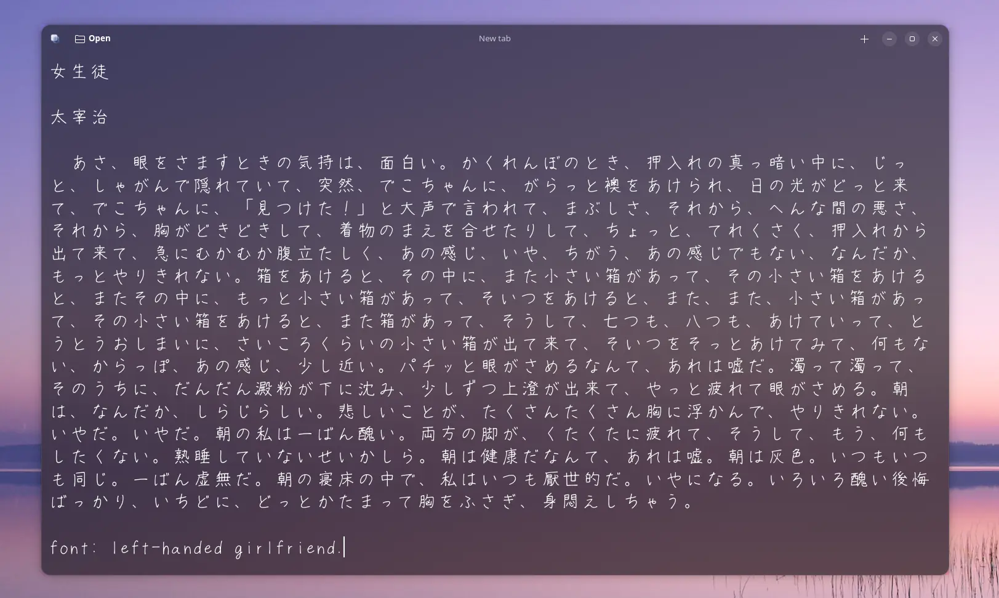

<p align="center">
  
</p>

<p align="center">
  
  
  
</p>

maha is a small text editor for the Linux desktop. It is built with GTK4 and libadwaita, so it picks up the system light/dark preference and looks like the rest of your apps. Under the hood it is deliberately boring: plain text only, no syntax highlighting, no plugins. The part that is not boring is file handling, because a notepad that loses your work is useless.

I created this project because I wanted a dead simple notepad with a modern and clean interface. I wanted transparency and blur. But nice aesthetics aside, the main reason is cos I needed an extremely fast and reliable notepad. You see, my laptop has a faulty motherboard and it randomly reboots. I often lose my work and that frustrates me.

Though the best editor I've been using that fit my needs has been VS Code, I wanted something focused. My inspiration of design was Apostrophe, the Markdown editor from the GNOME team (god I love that app!!!). 

But I have to be honest with you: I needed this app, but I don't have for it... at least for these months. Thus, I built it with heavy AI assistance, then reviewed, tested, and debugged by myself. The design decisions below (atomic writes, corruption recovery, session handling) came out from my own needs. Everything is modular for easier audits too.


> [!NOTE]
> Note that blur is something applied by the compositor of your desktop environment,
> not something I can bundle or control from maha. I can only add transparency support.
>
> For blur, check on your specific desktop environment.
> The images below are KDE Plasma 6 + better-blur-dx plugin





## Features

- Tabs.
- Autosave on a debounce, on by default (since I always need autosave, I set no autosave disabling mechanism).
- Atomic writes, so a crash never leaves a half-written file.
- Recovery for text files with NUL corruption (a crash can zero-fill a file's tail), applied non-destructively: the file is only rewritten when you save.
- Binary files (images, PDFs, executables) are never mistaken for corrupt text. maha warns and only offers to open them read-only, so they can never be overwritten.
- Unsaved documents are backed by a scratch file, so a "New tab" survives a crash before you ever name it (just like VS Code does).
- Closing a new tab that still has unsaved text asks whether to save, discard, or cancel.
- Session restore: reopens every tab from the previous run (files and unsaved tabs), with the previously active tab focused.
- Opens files from the command line (`maha file.txt`) or a file manager.
- Configurable window transparency, font family, font size, and line height. All of them can be set through a config file (more info in the Configuration section below), but you can also set the font size temporarily (session-only) using keyboard shortcuts.
- Follows the system light/dark theme.

## Requirements

- A Vala compiler (`valac`)
- Meson and Ninja
- `glib-2.0` and `gio-2.0`
- `gtk4` (>= 4.10)
- `libadwaita-1` (>= 1.5)

For the GUI smoke test you also need `Xvfb`, `xdotool`, and `dbus-run-session`. The test skips itself if they are missing.

## Build and run

To just generate the binary:

```sh
meson setup build
meson compile -C build
./build/src/maha
```

To install it (local install):

```sh
meson setup build --prefix ~/.local
meson install -C build
```

## Keyboard shortcuts

| Action            | Shortcut       |
| ----------------- | -------------- |
| New tab           | `Ctrl+T`       |
| Open              | `Ctrl+O`       |
| Save              | `Ctrl+S`       |
| Close tab         | `Ctrl+W`       |
| Reopen closed tab | `Ctrl+Shift+T` |
| Increase font size | `Ctrl++` |
| Decrease font size | `Ctrl+-` |
| Quit              | `Ctrl+Q`       |

## Configuration

Settings live in `~/.config/maha/config.ini` and are not exposed in the UI because I wanted to keep it as clean as possible (personal preference). The file is created with defaults on first run. A malformed file is never overwritten, and any missing or invalid key just falls back to its default. Default config/values are:

```ini
[appearance]
transparency=0.85
font=Monospace
font_size=11
line_height=0

[editor]
autosave_ms=1500
```

`transparency` is the window background opacity, clamped to 0.05 through 1.0. `font` is a Pango family name. `font_size` is in points. `line_height` is a multiple of the font size (0 keeps the font's natural spacing, e.g. `1.4` opens the text up). `autosave_ms` is the debounce delay before a change is written; be conscious with this value, because if it is too low you will cause unnecessary wear to your SSD.

The session file at `~/.config/maha/session` remembers every open tab (files and unsaved tabs) and which one was active. Scratch files for unsaved tabs go in `~/.cache/maha/`.

## How it works

**Atomic saves.** `save_atomic` never writes over your file in place. It writes a temporary file in the same directory, flushes it with `fsync`, then renames it over the destination and flushes the directory. A crash at any point leaves either the old file or the new one, never a mix of the two. See `src/file_store.vala`.

**Reading is read-only.** Opening a file never modifies it. maha classifies the bytes first: valid UTF-8 is text; a file whose tail was zero-filled by a crash is reported as corruption and its recoverable prefix is shown, but the file is rewritten only if you save; anything else (binary data, invalid UTF-8, control-heavy bytes) is refused, and you can choose to open it read-only, where it can never be written back. Only regular files are opened (a FIFO or device is refused rather than read forever), and files above 64 MiB are declined to keep memory in check.

**Autosave.** Editing a document arms a debounce timer. When it fires, the current text is pulled from the editor and written through the same atomic path. Text is pulled lazily at save time, so typing in a large file does not copy the whole buffer on every keystroke. See `src/auto_saver.vala`.

**Scratch files and the session.** A document with no path is backed by a UUID-named scratch file in the cache directory. That way the text exists on disk before it has a name, and a crash cannot lose it. The session store remembers every open tab (each one a real file or a scratch id) and which tab was active, and restores them all on the next run.

## Testing

```sh
meson test -C build
```

The core suite has 64 tests covering document state, atomic I/O, corruption recovery, binary detection, config parsing, autosave, and session handling. There is also a headless GUI smoke test that launches the real binary under Xvfb and sends `Ctrl+S`, which guards the GTK shortcut controller that the unit tests cannot reach.

## Troubleshooting

### Flickering white specks on the transparent window

On some Wayland setups (notably AMD GPUs with Mesa), GTK's Vulkan renderer can present visual artifacts (small flickering white points) in the non-opaque regions of a translucent window. maha is affected because its whole window gets translucent when you set a value lower than 1.0 in the config file.

The workaround as for now is to disable the Vulkan renderer's damage-region ("incremental") present (I got this solution from the gnome docs):

```sh
GDK_VULKAN_DISABLE=incremental-present maha
```

To make it permanent, put it in the desktop entry's `Exec` line
(`Exec=env GDK_VULKAN_DISABLE=incremental-present maha`) or export it in your
session environment. The CPU renderer also avoids it (`GSK_RENDERER=cairo maha`),
and so does setting `transparency=1.0`, since the window is then opaque.


## License

MIT. See [LICENSE](LICENSE).
